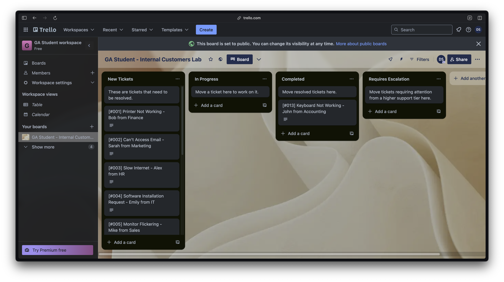
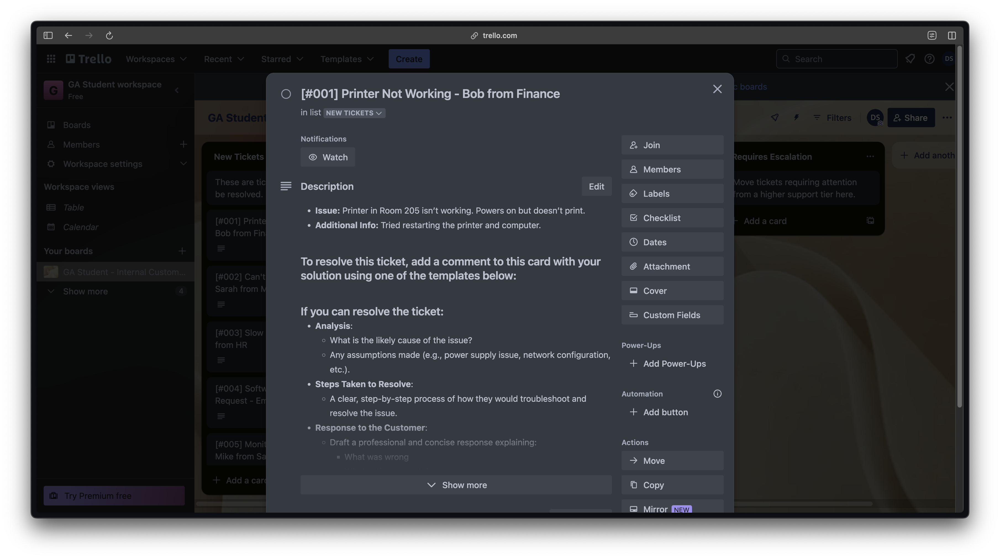
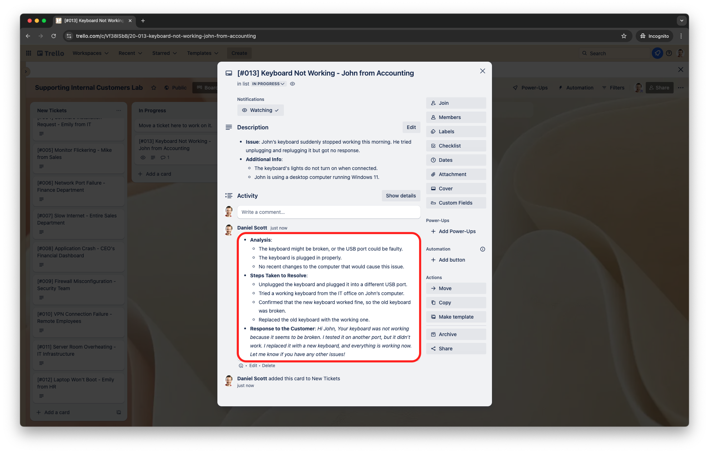

<h1>
  Supporting Internal Customers Lab
  Exercise
</h1>

**Learning objective:** By the end of this exercise, students will be able to resolve and escalate technical tickets in a help desk environment.

## Overview

This lab aims to simulate a real-world help desk environment using an internal customer support ticketing system to manage and resolve issues. You will document your resolution process systematically following the procedure outlined below.

This process will allow you to practice your communication and technical writing skills as you summarize your ticket resolutions. These skills are essential for all tech professionals who wish to foster collaboration with support teams.

## Understanding the board's structure

Before beginning the lab, please review the setup documentation to ensure you're prepared to follow along and complete this assignment.

Once you've made a copy of the lab Trello board, you should see the following structure:

This Trello board organizes ticket cards into the following lists:

1. **New Tickets**: These are open, unresolved tickets; you'll start your work by selecting a ticket card from this list and moving it to the **In Progress** list.

2. **In Progress**: These are tickets you are actively working on.

3. **Completed**: Once you resolve a ticket, you'll move it to this list, ensuring you've added the required documentation as a comment.

4. **Requires Escalation**: Tickets that require knowledge beyond your scope, impact a critical business operation, involve a VIP customer, or require input from another department should go here. You must document why you've escalated each ticket that meets this criteria.

> 📚 If you're new to using Trello, the columns on your board holding the ticket cards are called ***lists***.

Before you begin the lab, all the cards should be in the **New Tickets** column; there will be 12 ticket cards in total. Try selecting the first ticket card ***(ticket ID #001)*** to see how the ticket cards are formatted.

Each ticket card includes:

1. A ticket title in the following format: `[<ticket id>] <ticket description> - <ticket originator> from <department name>`.
2. A description of the issue.
3. Additional information or context (if applicable).
4. Instructions on how to document your resolution or escalation.

Once you familiarize yourself with the board, proceed to the next step.

## Working on the tickets

Your assignment for this lab is to resolve *(move to the **Completed** list)* or escalate *(move to the **Requires Escalation** list, if applicable*) a minimum of 6 tickets. Please note that it's possible for none of the tickets you complete to require escalation, depending on which ones you choose. However, it's up to you to *make the right call* when resolving tickets effectively.

To get started with the assignment, here's a suggested workflow:

1. **Start with a ticket card**:

   - Choose a ticket card from the **New Tickets** list and drag it to the **In Progress** list.
   - Review the ticket details by clicking on the ticket card.

2. **Analyze the issue**:

   - Review the ticket description and additional information.
   - Come up with a list of assumptions regarding the issue.
   - Formulate a list of steps to resolve the ticket.

3. **Document your solution**:

   - Use the provided template to document your solution as a comment on the ticket card.
   - Ensure you provide documentation for each aspect of the template:
     - Your analysis of the issue ***(what caused it, and any assumptions made)***.
     - The steps you took to resolve it ***(ensure these are clear and step-by-step)***.
     - A professional response to the customer summarizing the solution ***(be sure to explain what was wrong and what actions you took, and confirm the next steps, which should be "issue resolved/completed" or "requires escalation")***.

4. **Complete the ticket**:

   - Once you resolve a ticket, drag the ticket to the **Completed** list.

**Here's an example of what a resolved ticket should look like:**

### Knowing when to escalate

Despite your best efforts, sometimes you won't be able to resolve a ticket independently; this is a critical skill in IT Support that takes a lot of practice to become proficient in.

Here's how to decide if a ticket requires escalation:

- **Assess issue complexity**:

  - Does the problem involve systems, configuration, or permissions outside your scope?
  - Are specialized tools or expertise needed to troubleshoot the issue?

- **Determine business impact**:

  - Does the issue affect company-wide systems or VIP users?
  - Is it a time-sensitive issue requiring immediate attention from a higher support tier?

- **Verify troubleshooting efforts**:

  - Have you ruled out common causes?
  - Have you identified issues you can't resolve with your current resources?

If you believe your ticket meets the above criteria, clearly document your escalation decision before moving it to the"Requires Escalation" list.

Here's what to include in your documentation comment:

- **Steps attempted to resolve**:

  - A clear step-by-step process you attempted to troubleshoot and resolve the issue.

- **Why escalation is required**:

  - List a few reasons why you are unable to resolve this issue.

- **Recommendations**:

  - Provide details that may assist the next support tier.

- **Response to the customer**:

  - Explain what you tried and why it didn't work.
  - Re-align expectations.
  - Let them know you've escalated the ticket and to stand by for further communication from the next support tier.

> 💡 Pro Tip: When escalating a ticket, communicate with urgency and professionalism; this way, the next team can easily pick up where you left off without delays.

## Submitting your work

Before you submit your board, you should have completed at least six tickets; however, if you have time, please complete as many remaining ones as possible for additional practice.

As a best practice, please perform the following before submitting your board:

- **Review your board**:

  - Verify that you've moved at least six tickets to the **Completed** and **Requires Escalation** lists (if escalation was necessary to complete any of your tickets).
  - Ensure each ticket, **Completed** or **Requires Escalation**, has a fully documented comment.

Please ask your instructional team if you have questions regarding the submission process.
