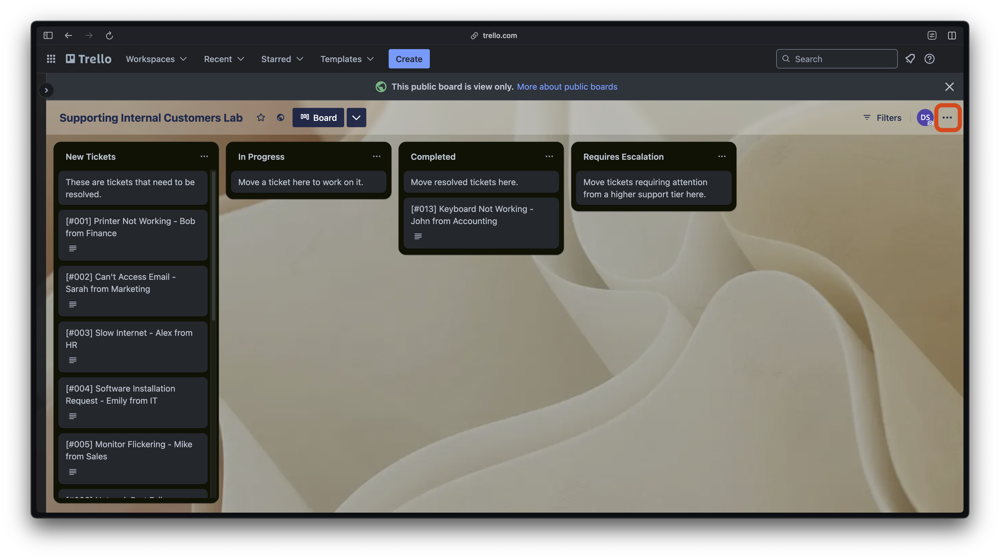
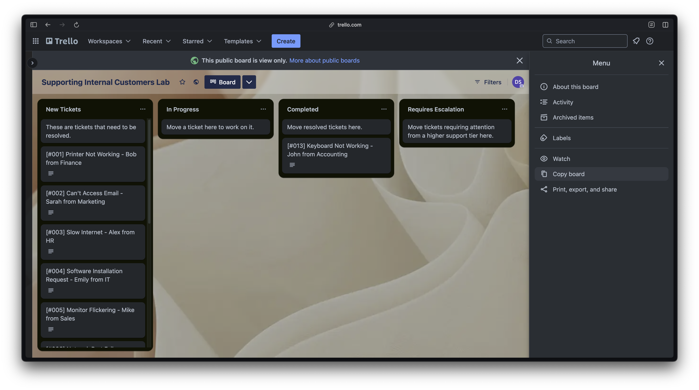
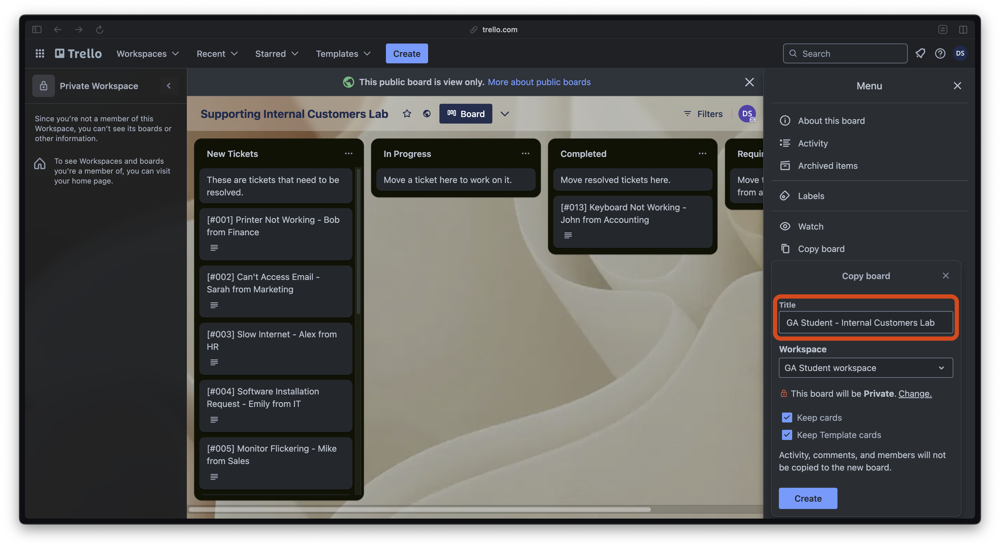
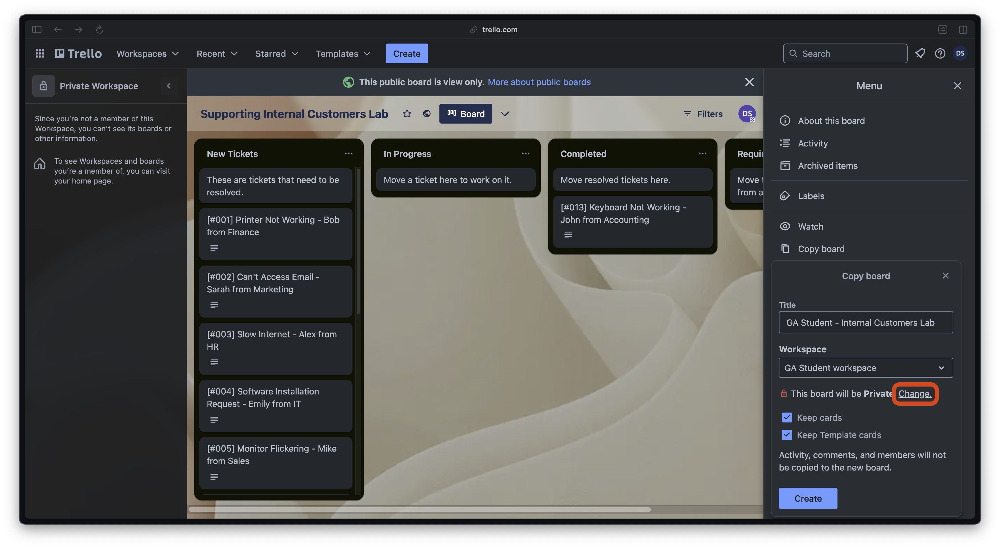
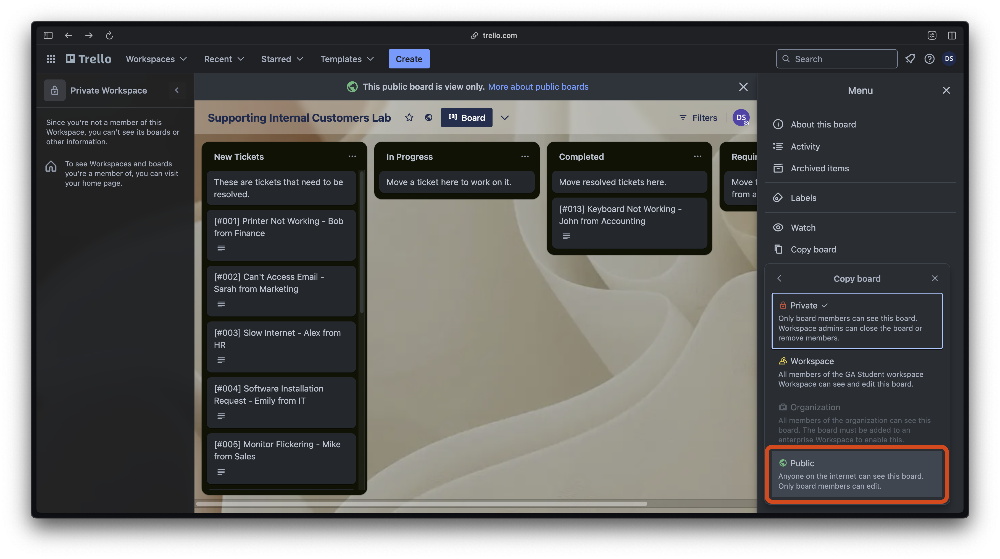
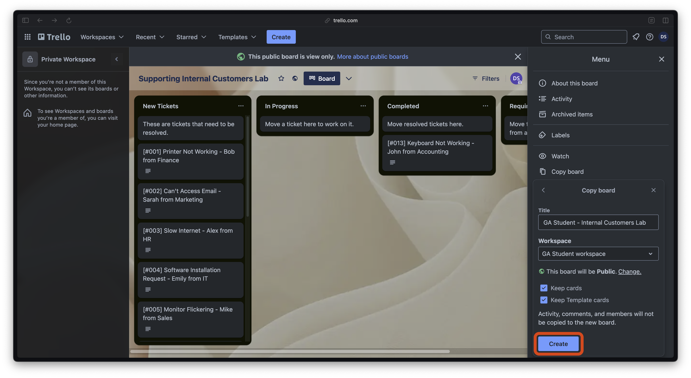

<h1>
  Supporting Internal Customers Lab
  Setup
</h1>

## Setup

### Overview

In this lab, you will use a Trello board configured to simulate a help desk environment. The board comes complete with internal customer support tickets you must resolve using a structured process while documenting your solution.

### Accessing the Trello board

1. **Sign in to Trello.** You may already have a free Trello Account; if you don't have one, you can create one [here](https://id.atlassian.com/signup?application=trello).

2. **Access the template Trello [here](https://trello.com/b/FnPN88W4).**

   > 💡 The Trello board is in ***view-only*** mode.

3. **Make a copy of the board**:

   - Go to the upper-right corner of the board and select **...** outlined in red in the screenshot below.

     

   - Select the **Copy Board** option from the dropdown menu outlined in red in the screenshot below.

     

   - Make the title of the board `<Your Name> - Supporting Internal Customers Lab`, replacing `<Your Name>` (including the `<` and `>`) with your name - for example, **Jane Doe - Supporting Internal Customers Lab**.

     

   - Set the board visibility to public by selecting the **change** option outlined in red in the first screenshot and then the **Public** option outlined in red in the second screenshot. A message will appear asking you to confirm this change. Select the **Yes, make board public** option.

     

     

     > 🚨 This step is incredibly important! No one can see your board unless it is public.

   - After confirming you've named your board correctly and that it is public select the **Create** button outlined in red in the screenshot below.

     

### Final check before you begin

You should now have your own copy of the Trello board, which you've renamed using the recommended format. You should be able to interact with the ticket cards. Please contact your instructor if you couldn't complete any of these steps or have any questions regarding this setup.

You will submit a link to the Trello board to complete this lab. Please ensure that the link you submit is to your own copy of the board and that it is public.

Assuming your setup was successful, you can proceed to the exercise portion of the lab to better understand this assignment.
